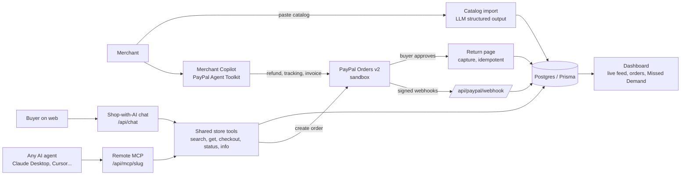

# OpenAisle

**Make any small shop buyable by AI agents, paid with PayPal.**

Built for the [PayPal AI Hackathon](https://paypalaihackathon.devpost.com/).

| | |
|---|---|
| **Live demo** | https://openaisle.onrender.com |
| **Demo store (shop with AI)** | https://openaisle.onrender.com/s/kaveri-handlooms |
| **Merchant dashboard** | https://openaisle.onrender.com/dashboard/kaveri-handlooms |
| **Demo video** | https://www.youtube.com/watch?v=4S3O6zRSP4g |
| **License** | MIT |

> Everything runs on the **PayPal sandbox**. No real money moves.

---

## The problem

AI assistants (ChatGPT, Claude, Perplexity, Copilot) are becoming a shopping channel. PayPal's own agentic-commerce services, Agent Ready and Store Sync, are limited-availability: a merchant has to submit an access request and wait for onboarding. A small cross-border seller, for example an Indian handloom exporter selling to US buyers, has no engineers and no way in.

## What OpenAisle does

1. **Agent-ready catalog.** A merchant pastes a messy product list (WhatsApp-style notes, spreadsheet text). The AI turns it into clean structured products, writes an agent-friendly summary for each, and gives the catalog an **Agent-Readiness Score** with concrete fixes.
2. **A remote MCP endpoint per store.** Every store gets `https://<host>/api/mcp/<store-slug>` (Streamable HTTP). Any MCP-capable assistant (Claude Desktop, Cursor, custom agents) can search the store and check out. A "Shop with AI" chat on the storefront uses the **same five tools**. A plain-text `llms.txt` is published for agent discovery.
3. **Real PayPal checkout, supervised.** The agent *proposes* a purchase; the buyer approves and pays on PayPal. The agent never captures payment.
4. **Merchant dashboard.** A live feed of every agent interaction (search, view, checkout, payment, refund) across web chat and MCP, plus orders, revenue and conversion.
5. **Missed Demand.** The AI clusters searches that returned nothing ("indigo silk scarf", "men's kurta") into product opportunities with a suggested product and price range.
6. **Merchant Copilot** built on the **PayPal Agent Toolkit**: refund an order, add shipment tracking, create and send an invoice, look up orders, in plain language. Clear commands ("Refund OA-1003", "Add tracking … to OA-1001", "Invoice …") are parsed and executed directly through the toolkit with no LLM call; free-form questions go to the AI.

## Trust model for agent checkout

- Prices, totals and currency are **recomputed server-side from the database**. The AI or MCP client cannot set or change a price.
- Per-store limits: maximum order value, stock checks, quantity caps. Violations are logged as `POLICY_BLOCKED` events.
- The web chat requires an explicit buyer confirmation before an order is created.
- Payment is captured only after the buyer approves on PayPal (return page, or the signed webhook). Capture and webhook handlers are **idempotent**, and only one request can flip an order to `COMPLETED`.
- PayPal webhooks are verified with PayPal's `verify-webhook-signature` API.
- Every tool call is written to an audit feed.

## How PayPal is used

| PayPal capability | Where |
|---|---|
| **Orders v2**: create (itemized, `PAY_NOW`, return/cancel URLs) and capture | `src/lib/paypal.ts`, `src/lib/store-tools.ts`, `src/lib/checkout.ts` |
| **PayPal Agent Toolkit** (`@paypal/agent-toolkit`): get order, create refund, create shipment tracking, create invoice, send invoice | `src/lib/copilot.ts` |
| **Payments**: refunds (via the toolkit) | `src/lib/copilot.ts` |
| **Invoicing**: create and send (via the toolkit) | `src/lib/copilot.ts` |
| **Shipment tracking** (via the toolkit) | `src/lib/copilot.ts` |
| **Webhooks**: `PAYMENT.CAPTURE.COMPLETED`, `PAYMENT.CAPTURE.REFUNDED` with signature verification | `src/app/api/paypal/webhook/route.ts`, `src/lib/webhooks.ts` |
| OAuth with token caching and 401 refresh | `src/lib/paypal.ts` |

## How AI is used

| Use | Model | Where |
|---|---|---|
| Shopping agent with tool calling (5 tools) | Groq `openai/gpt-oss-120b`, automatic fallback to Google Gemini Flash | `src/app/api/chat/[slug]/route.ts` |
| MCP server tools for any external AI agent | (the client's own model) | `src/app/api/mcp/[slug]/route.ts` |
| Catalog normalization and readiness scoring (structured output) | Groq, Gemini fallback | `src/app/api/stores/import/route.ts` |
| Missed-demand clustering (structured output) | Groq, Gemini fallback | `src/lib/missed-demand.ts` |
| Merchant Copilot: tool calling over PayPal Agent Toolkit tools (clear commands skip the LLM) | Groq, Gemini fallback | `src/app/api/copilot/[slug]/route.ts`, `src/lib/copilot-commands.ts` |

Both providers are free-tier. The app trims history, keeps prompts short, falls back to Gemini on 429 and 5xx errors, and rate-limits public endpoints per IP (chat and Copilot 12/min, catalog import 4/min, MCP 60/min with at most 10 checkouts per hour).

## Architecture



**Stack:** Next.js (App Router) · TypeScript · Tailwind + shadcn/ui · Prisma + Postgres · Vercel AI SDK · `mcp-handler` (MCP, Streamable HTTP) · `@paypal/agent-toolkit` · Render.

## Try it (2 minutes, no setup)

1. Open the **demo store**: https://openaisle.onrender.com/s/kaveri-handlooms
2. In the chat, type: *"Find a silk scarf under $50"*, then say *"Yes, buy the first one"* and confirm.
3. Click **Pay with PayPal** and log in with the sandbox buyer:
   - **Email:** `sb-e4grz53857844@personal.example.com`
   - **Password:** `VmG4*0pe`
   - (PayPal **sandbox** test account with fake funds; no real money.)
4. Approve the payment. You return to a receipt, and the order appears in the **dashboard** feed.
5. In the dashboard **Copilot**, type *"Refund the most recent order"* (runs instantly through the PayPal Agent Toolkit, no LLM). Then try a free-form request like *"What did my store earn this week and what are agents asking for that I don't sell?"*.

### Connect your own AI assistant (MCP)

Claude Desktop → Settings → Developer → Edit config:

```json
{
  "mcpServers": {
    "kaveri-handlooms": {
      "command": "npx",
      "args": ["-y", "mcp-remote", "https://openaisle.onrender.com/api/mcp/kaveri-handlooms"]
    }
  }
}
```

Restart Claude Desktop and ask: *"Find me a handwoven cotton scarf under $40 and check out."* Clients that support Streamable HTTP can use the URL directly.

## Run locally

```bash
cp .env.example .env.local   # fill in values (see below)
npm install
npm run db:push
npm run seed                 # (re)creates the demo store with products and sample searches
npm run dev
```

| Variable | Purpose |
|---|---|
| `DATABASE_URL` | Postgres connection string |
| `PAYPAL_CLIENT_ID`, `PAYPAL_CLIENT_SECRET` | PayPal **sandbox** REST app credentials |
| `PAYPAL_ENV` | `sandbox` |
| `PAYPAL_WEBHOOK_ID` | ID of the webhook registered for `/api/paypal/webhook` |
| `GROQ_API_KEY` | Groq free tier |
| `GOOGLE_GENERATIVE_AI_API_KEY` | Gemini free tier (fallback) |
| `APP_URL` | Public base URL (PayPal return URLs, MCP URLs) |

Deploys to Render with the included `render.yaml`.

## Known limitations

- Sandbox only; the dashboard and Copilot are intentionally open so judges can try them, and have no merchant login. Public endpoints have basic per-IP rate limiting; a production version needs merchant authentication.
- Free-tier LLM limits can briefly show an "AI is busy" message; the app retries on a second provider.
- Store Sync and Agent Ready are not used: they require PayPal's access approval.

## License

MIT. See [LICENSE](LICENSE).
